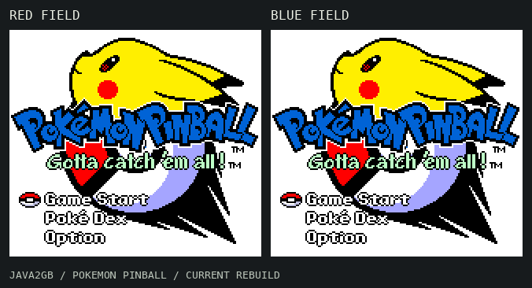
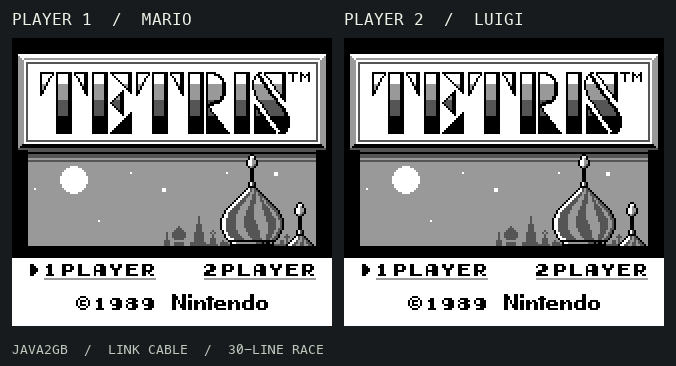

# Java2GB

This project demonstrates proof-of-concept programs written in Java and compiled for the Game Boy platform. We demonstrate this with two demos: **Pokémon Pinball** and **Tetris with Game Link multiplayer**.





Java is AOT compiled through **TeaVM IR → C → GBDK/SDCC → native machine code**. Game logic lives in Java, with a small shared native layer for hardware access. The demos run the compiled ROMs in emulation; Tetris supports original-cartridge interoperability.

### Example code

A simplified input-and-render update looks like this, with tile graphics already loaded:

```java
@RomData(bank = 0)
private static final byte[] PATTERN = {0, 1, 1, 0, 1, 0, 0, 1, 1, 0};

private static final byte[] row = new byte[10];

@Mutable
private static void resetRow() {
    for (byte i = 0; i < PATTERN.length; i++) {
        row[i] = PATTERN[i];
    }
}

public static void update() {
    GameBoy.waitFrame();
    final int buttons = GameBoy.buttons();
    if ((buttons & GameBoy.A) != 0) {
        resetRow();
    }
    RomMemory.copyToVram(row, 0, 0x9800, 0, row.length);
}
```

`@RomData` places immutable data in cartridge ROM, `@Mutable` declares array writes, and the hardware APIs expose controller input, frame timing, and video memory transfers. These APIs live in `dev.java2gb.api`.
